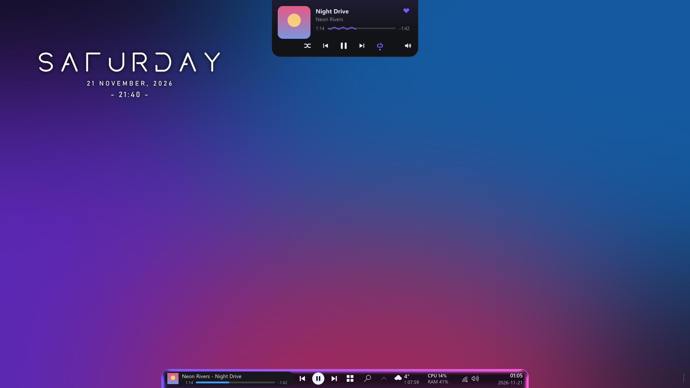
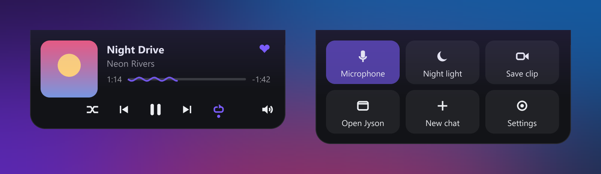
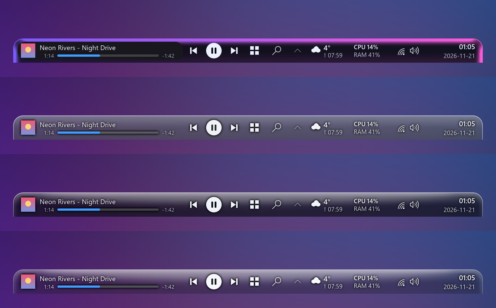
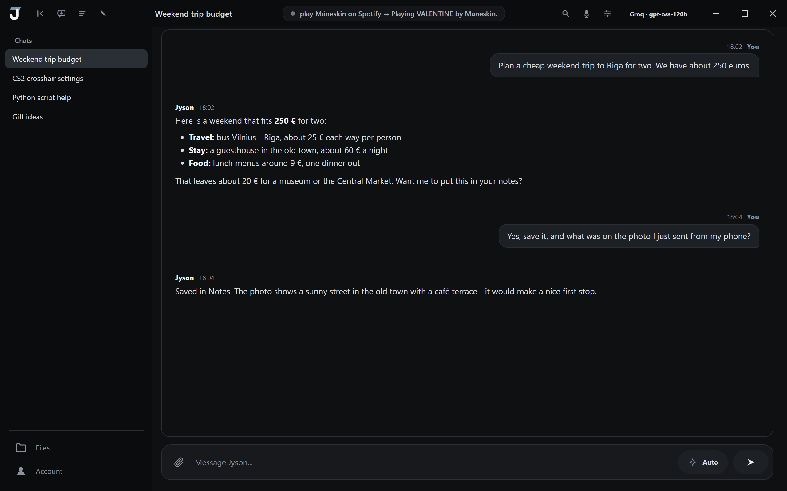
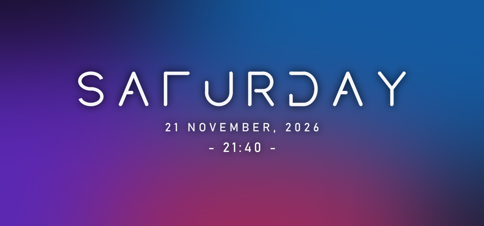

# Jyson

**Your Windows desktop, rebuilt. With an assistant you can talk to.**

[Website](https://get-jyson.netlify.app) · [Download](https://github.com/MrSausainis/Jyson/releases/latest) · [Changelog](CHANGELOG.md)

## Jyson Mochi

A small island at the top of the screen. The song, a timer, the answer to a command. Hover it for the player, scroll
it for quick settings.

## A taskbar that's yours

At the bottom, or at the top around Mochi. Neon, Frosted, Liquid glass or clear. Drag widgets onto it: weather, CPU,
GPU, timers, your music and more.

## Talk to it

> **"Jyson, open Spotify and play my liked songs."**
> **"Set a timer for 25 minutes."**
> **"Turn the volume down and open Discord."**
> **"What do you remember about me?"**

Say the wake word or hold a key. Chats stay in their own window; quick commands go to the activity list.

## And more

| | |
|---|---|
| **Clips** | One key saves the last 30 seconds of your game, with your voice. Trim it, shrink it for Discord. |
| **Desktop widgets** | A big clock, today's plan, a calendar with your own photo. |
| **Files** | Photos, videos and clips in one place, with search. |
| **Your AI** | A cloud provider with your own key, or a model on your own PC. |
| **Game-friendly** | Stays out of the way while you play. Hotkeys still work. |

## Install

1. Download **`Jyson-AI-Setup.exe`** from the [latest release](https://github.com/MrSausainis/Jyson/releases/latest).
2. Run it. Windows SmartScreen may warn the first time (the installer isn't code-signed yet).
3. Updates are signed and keep your settings.

**Needs:** Windows 11. Cloud AI needs your own provider key; local AI is optional.

## Free, plus a trial

Jyson works on **Free**. Every account can take a **free 14-day trial** of everything, no card.
Paid plans come later: see the [website](https://get-jyson.netlify.app).

## Privacy

Chats, files and settings stay on your PC. Your messages go only to the AI provider you picked. Keys are encrypted
with Windows' own protection. [Privacy policy](https://get-jyson.netlify.app/privacy)

## License

Proprietary, **all rights reserved**. You may download and use Jyson from the official releases, but not copy,
redistribute or modify it. See [LICENSE](LICENSE).
